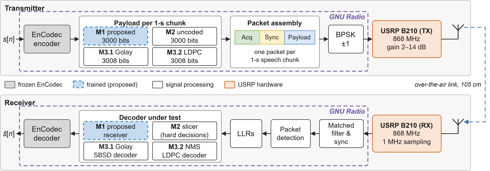
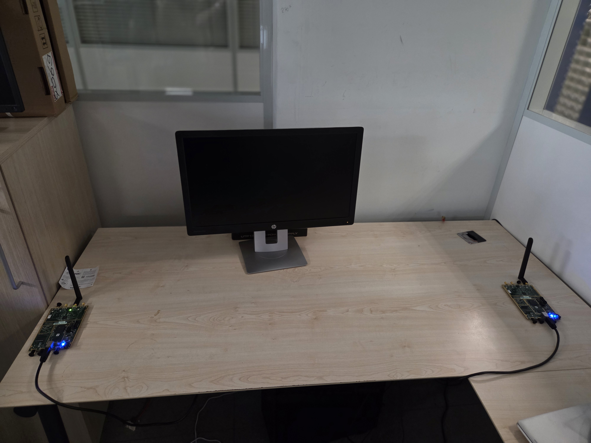

<div align="center">

# Low-Latency Deep-JSCC for Neural Speech Codecs With Over-the-Air Validation

**Code, trained models and measurement data for the paper submitted to IEEE WCNC 2027**

[](LICENSE)
[](#citation)
[](#environment-setup)
[](#4-gnu-radio-and-uhd-ota-only)
[](https://hisar-research.github.io/usrp-digital-jscc-audio/)

[**🎧 Audio demo**](https://hisar-research.github.io/usrp-digital-jscc-audio/) ·
[Simulation](sim/README.md) ·
[OTA testbed](ota/README.md) ·
[Environment setup](#environment-setup) ·
[Citation](#citation)

</div>

---

Neural speech codecs such as [EnCodec](https://github.com/facebookresearch/encodec) compress speech to a few kilobits per second, but a single bit error in a codebook index can corrupt the decoded audio. Classical channel codes fix this only by waiting for long blocks, which adds latency.

This project protects EnCodec's residual vector quantization (RVQ) indices with a **learned, frame-by-frame joint source-channel code (Deep-JSCC)**. Every 13.3 ms EnCodec frame carries 30 index bits (3 RVQ layers) plus 10 learned parity bits, 40 bits in total, or **3 kbps**. A causal, soft-input neural receiver corrects the indices before EnCodec decodes them, so decoding never waits for more than one frame.

The method is evaluated in two ways:

1. **Software simulation**: AWGN and block-Rayleigh channels with exact E<sub>s</sub>/N<sub>0</sub> control.
2. **Over-the-air (OTA) testbed**: two USRP B210 radios at 868 MHz running a GNU Radio BPSK link. All methods are sent in the same packet so they see the same channel.


## Highlights

- **Frame-level latency.** The proposed receiver decodes each 13.3 ms frame as soon as it arrives. A rate-3/4 LDPC code at the same bit rate needs about **1016 ms**.
- **Robust at low SNR.** At E<sub>s</sub>/N<sub>0</sub> = −5 dB on AWGN, the proposed scheme reaches an ESTOI of **0.430**, against 0.306 for a block code with softbit source decoding and 0.043 for LDPC. Above about 0 dB on AWGN the classical codes catch up; [`deploy_soft/README.md`](deploy_soft/README.md#results) has the full tables.
- **Validated over the air.** Four methods share one RF super-packet per 1-second speech chunk. The receiver saves decoded audio, PESQ/ESTOI scores, IQ symbols and LLRs for every detected packet.
- **Runs on a laptop.** The simulation needs only a CPU. The trained model, EnCodec codebooks, SBSD prior and 100 test clips are all in the repository.

## Audio demo

**[Listen to the samples →](https://hisar-research.github.io/usrp-digital-jscc-audio/)**

The demo page plays three LibriTTS utterances received over the air at USRP TX gains of 31, 33 and 35 dB. Each one is decoded with the proposed Deep-JSCC receiver, uncoded EnCodec at 3 kbps, EnCodec + convolutional code, and EnCodec + LDPC, next to the original recording.

## Over-the-air testbed

<p align="center">
  
</p>
<p align="center"><em>Signal chain of the OTA testbed. GNU Radio handles everything inside the dashed boxes; the two B210 radios are 105 cm apart.</em></p>

<p align="center">
  
</p>
<p align="center"><em>The testbed: transmitter and receiver B210s on the same desk, both driven by one host PC.</em></p>

**How a measurement runs.** The Python transmitter encodes a LibriTTS utterance with EnCodec in 1-second chunks. For each chunk it builds the four payloads and sends one **1,502-byte super-packet** (12,016 payload bits) to GNU Radio over UDP. The order of the four methods rotates from chunk to chunk. GNU Radio adds acquisition and sync fields, BPSK-modulates the packet, and transmits it. On the receive side, GNU Radio detects the packet and passes soft values back to the Python receiver. The receiver decodes all four methods, rebuilds the speech, and scores it against the original.

USRP TX gain is an **experimental setting, not a measured SNR**. OTA results are plotted against TX gain, and simulation results against modelled E<sub>s</sub>/N<sub>0</sub>.

## Methods compared

All methods spend the same budget: about 3,000 bits per 1-second chunk (40 bits per EnCodec frame).

| Method | Payload | Receiver | Decoding latency | Simulation | OTA |
|---|---|---|---|:---:|:---:|
| **Proposed Deep-JSCC** | 3 RVQ layers (30 bits) + 10 learned parity bits per frame | Causal soft-input CNN | 13.3 ms | M1 | `proposed` |
| Uncoded EnCodec | 4 RVQ layers (40 bits) per frame, 3.0 kbps | Hard-decision slicer | 13.3 ms | M2 | `3` |
| Block code + SBSD | 3 layers + shortened Hamming parity, 10 bits per frame | Softbit source decoding with a Markov index prior | 13.3 ms | M3.1 | – |
| Convolutional code | 3 layers; K = 7, (133,171)<sub>8</sub>, punctured to rate 3/4; 3,008 bits per chunk | Soft Viterbi over the 1-s chunk | 1 chunk | – | `conv` |
| LDPC | 3 layers; (3008, 2256) code, rate 3/4 | Normalized min-sum | ≈ 1016 ms | M3.2 | `ldpc` |

The **Simulation** column gives the method IDs used in [`deploy_soft/`](deploy_soft/README.md). The **OTA** column gives the `method` labels in the measurement CSV files.

> **Label clash:** in the OTA block diagram, **M3.1 is the convolutional code**. In the simulation, M3.1 is the block code + SBSD.

The OTA model is the 3-layer + 10-parity soft bundle in `reference_soft/bundle_3_out_4/`. It has the same trained weights as the simulation bundle in `deploy_soft/bundle/` (`run_id` `fa03d421aa9837a8`). The other bundles in this repository are different model variants and are not interchangeable.

## Repository layout

```text
.
├── README.md                     This file
├── requirements.txt              Python dependencies (simulation, OTA scripts, benchmarks)
├── LICENSE                       Apache License 2.0
│
├── deploy_soft/                  SOFTWARE SIMULATION: self-contained, CPU only
│   ├── README.md                 Methods, full results, options and outputs
│   ├── selftest_sim_v3.py        All methods, channels and metrics
│   ├── plot_sim_v3.py            Figures and summary tables from a finished run
│   ├── vogeo_tx.py               Learned transmitter: EnCodec indices to 40-bit frames
│   ├── vogeo_rx.py               Learned soft receiver: LLRs to corrected indices
│   ├── vogeo_frame.py            Frame format shared by both ends
│   ├── bundle/                   Trained model and EnCodec codebooks
│   ├── sbsd_prior_nq3.npz        Markov index prior for the SBSD baseline
│   └── test_data/                100 LibriTTS test clips
│
├── ota/                          OVER-THE-AIR EXPERIMENT
│   ├── README.md                 Hardware, run order, packet format, capture files
│   ├── tx_four_methods_with_ldpc_iq_capture.py    Transmitter (Python)
│   ├── rx_four_methods_soft_ldpc_iq_llr_capture.py Receiver, decoders and metrics
│   ├── bpsk_jscc_RX_iq_capture.grc                GNU Radio flowgraph for both radios
│   ├── graphs.py                 PESQ / ESTOI / SI-SDR against TX gain
│   ├── calculate_sisdr.py        SI-SDR from saved audio
│   ├── measurement_30 oct/       Measured metric tables
│   ├── measurement_before_30 oct/  Earlier measurement tables
│   └── old/                      Archived snapshot of the previous layout
│
├── reference_soft/               Learned TX/RX as an importable package (used by ota/)
│   ├── bundle_3_out_4/           3 layers + 10 parity bits: the OTA model
│   └── bundle_soft/              2 layers + 20 parity bits: a different variant
│
├── deepJSCC_voice_hard_1_2/      Earlier hard-decision model, kept for reference
├── benchmark_processing_latency.py  Processing-latency benchmark (earlier 3-method comparison)
├── benchmark_tx_stage_latency.py    TX-stage latency benchmark
├── latency_*.csv, tx_stage_latency_*.csv  Benchmark outputs
│
└── docs/                         Audio demo site (GitHub Pages), block diagram, photo
```

## Environment setup

Tested on Linux with **Python 3.12**, CPU only. The simulation needs only steps 1–3. The OTA experiment also needs step 4 and the hardware.

### 1. System packages

`pesq` builds a C extension, so you need a C compiler and the Python headers. On Ubuntu or Debian:

```bash
sudo apt install python3.12-venv python3.12-dev build-essential git
```

On macOS, install the Xcode command-line tools (`xcode-select --install`). On Windows, install the Microsoft C++ Build Tools.

### 2. Python environment

```bash
git clone https://github.com/Hisar-Research/usrp-digital-jscc-audio.git
cd usrp-digital-jscc-audio

python3.12 -m venv .venv
source .venv/bin/activate          # Windows: .venv\Scripts\activate
python -m pip install --upgrade pip

# CPU-only PyTorch: a much smaller download than the default CUDA build
pip install -r requirements.txt --extra-index-url https://download.pytorch.org/whl/cpu
```

If you want the CUDA build of PyTorch, drop `--extra-index-url`. No GPU is needed for anything in this repository.

<details>
<summary>Using conda instead</summary>

```bash
conda create -n jscc python=3.12 -y
conda activate jscc
pip install -r requirements.txt --extra-index-url https://download.pytorch.org/whl/cpu
```

</details>

### 3. Check the installation

```bash
cd deploy_soft
python selftest_sim_v3.py --selftest
```

This takes a few seconds, needs no audio, and should end with `self-test OK`. The first real run downloads the EnCodec 24 kHz weights through Torch Hub (89 MB, cached in `~/.cache/torch/hub/checkpoints/`), so it needs internet access once.

### 4. GNU Radio and UHD (OTA only)

GNU Radio and UHD are **not** pip packages, so install them system-wide. The flowgraph was saved with **GNU Radio 3.10.9**. On Ubuntu 24.04:

```bash
sudo apt install gnuradio uhd-host
sudo uhd_images_downloader         # FPGA images for the B210
uhd_find_devices                   # both B210s should be listed
```

[radioconda](https://github.com/ryanvolz/radioconda) is an alternative on any OS.

The Python scripts talk to GNU Radio only over local UDP ports and never import it. So GNU Radio Companion can run from the system installation while the Python scripts run from `.venv`.

## Quick start

### A. Run the simulation (no radio needed)

From `deploy_soft/`, with the environment active:

```bash
cd deploy_soft

# Short run: 2 clips, 2 SNRs, AWGN and Rayleigh
python selftest_sim_v3.py --test_dir test_data --seconds 0 --trials 1 \
    --max_files 2 --snrs 0 3 --channels awgn rayleigh \
    --mismatch_db 0 --out_prefix smoke

# Figures from that run
python plot_sim_v3.py --prefix smoke --out_dir figs_smoke --fmt png
```

The short run prints ESTOI tables for every method and writes `smoke_rows.csv`, `smoke_ceil.csv` and `smoke_summary.json`. The plotting step writes six figures to `figs_smoke/`. On a 32-core CPU the short run took under a minute; a laptop will be slower.

For the full sweep behind the paper's simulation results, the options and the output files, see [`deploy_soft/README.md`](deploy_soft/README.md).

### B. Plot the saved OTA measurements

```bash
cd ota
python graphs.py
```

This reads the tables in `ota/measurement_30 oct/` and writes PESQ, ESTOI and SI-SDR plots against TX gain into `ota/`, as PNG, PDF and EPS files. TX gain 89 dB is drawn as a horizontal reference line, not as a sweep point.

### C. Run an OTA measurement

You need two USRP B210s, GNU Radio and UHD (step 4 above), and the LibriTTS `test-clean` set. **[`ota/README.md`](ota/README.md) is the full guide**; this is the outline.

1. **Get the speech data.** Download LibriTTS `test-clean` (1.2 GB) from [OpenSLR 60](https://www.openslr.org/60/) into `datasets/`, which Git ignores:

   ```bash
   mkdir -p datasets && cd datasets
   wget https://www.openslr.org/resources/60/test-clean.tar.gz
   tar -xzf test-clean.tar.gz        # creates LibriTTS/test-clean/
   cd ..
   ```

2. **Fix the paths.** The OTA scripts look for `reference_soft/` and `datasets/` inside `ota/`. Until the scripts are updated, link them from the repository root:

   ```bash
   ln -s ../reference_soft ota/reference_soft
   ln -s ../datasets ota/datasets
   ```

3. **Point the flowgraph at your radios.** In `ota/bpsk_jscc_RX_iq_capture.grc`, the USRP sink (TX) and source (RX) select their B210s by serial number. Replace `serial=33559EA` and `serial=3367F2F` with the serials that `uhd_find_devices` reports. Also check the 868 MHz carrier against your local regulations.

4. **Start the three parts in this order**, each in its own terminal, from `ota/`:

   ```bash
   # Terminal 1: receiver. --tx-gain only labels the output files
   python rx_four_methods_soft_ldpc_iq_llr_capture.py --tx-gain 31
   ```

   - **Terminal 2:** open `bpsk_jscc_RX_iq_capture.grc` in GNU Radio Companion, set the TX gain to match the label, and start the flowgraph.
   - **Terminal 3:**

     ```bash
     python tx_four_methods_with_ldpc_iq_capture.py
     ```

The receiver writes decoded audio, PESQ/ESTOI tables and IQ/LLR captures under `ota/`. Repeat for each TX gain. The ports, packet format and capture file formats are in [`ota/README.md`](ota/README.md).

## Reproducibility notes

- **Metrics.** PESQ (narrowband) and ESTOI are computed by the OTA receiver and by the simulation. SI-SDR for the OTA tables comes from `ota/calculate_sisdr.py`, run on the saved audio.
- **Missing packets.** A packet the receiver does not detect has no IQ or LLR record. Its 1-second chunk is filled with silence in the reconstructed speech, so lost packets lower the score instead of being dropped from it.
- **Latency benchmarks.** The root-level `benchmark_*.py` scripts and `*latency*.csv` files come from an earlier three-method comparison. They are not four-method OTA latency measurements.
- **For any figure in the paper**, record the clip subset, TX/RX gains, receiver options, bundle `run_id`, packet detection counts, and how the confidence intervals were computed.

## Citation

The paper is under review at **IEEE WCNC 2027**. A BibTeX entry will be added here once it is accepted:

> *Low-Latency Deep-JSCC for Neural Speech Codecs With Over-the-Air Validation*, submitted to IEEE Wireless Communications and Networking Conference (WCNC), 2027.

Until then, please cite this repository:

```bibtex
@misc{hisar2026lowlatencyjscc,
  title        = {Low-Latency Deep-JSCC for Neural Speech Codecs With Over-the-Air Validation: Code and Data},
  author       = {{Hisar Research}},
  year         = {2026},
  howpublished = {\url{https://github.com/Hisar-Research/usrp-digital-jscc-audio}}
}
```

## License

The code in this repository is licensed under the [Apache License 2.0](LICENSE). Copyright 2026 Hisar Research.

Third-party material keeps its own terms:

* **EnCodec:** the system depends on Meta's EnCodec 24 kHz model, and `deploy_soft/bundle/codebooks.npy` contains codebooks from that model. These are covered by EnCodec's terms, not by this project's license. The PyPI package `encodec` 0.1.1 declares CC BY-NC 4.0, while the upstream repository's README states MIT for the code and gives no separate terms for the pretrained weights. Check EnCodec's current terms before any commercial use.
* **LibriTTS:** the original speech clips in `deploy_soft/test_data/` and `docs/audio*/original_audio/` are from [LibriTTS](https://www.openslr.org/60/), released under CC BY 4.0. The received audio under `docs/` is derived from these clips.
* **LibriSpeech:** the training audio is from [LibriSpeech](https://www.openslr.org/12/), released under CC BY 4.0.

Questions and bug reports: please open a [GitHub issue](https://github.com/Hisar-Research/usrp-digital-jscc-audio/issues).
